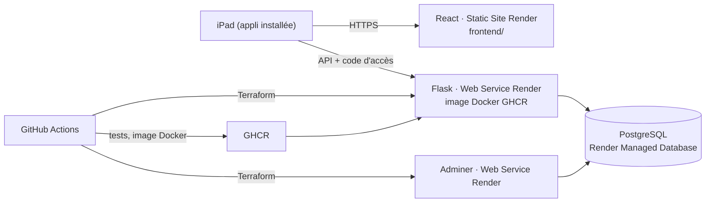

# Banc2Touche · plateforme Render

Banc2Touche est l'outil de banc pour coacher un match de handball sur iPad : saisie des tirs, gardiens, bilan de mi-temps, fiche PDF de fin de match. Ce dépôt en fait une plateforme industrielle, d'après l'[atelier Render](docs/ATELIER.md) : chaque commit est testé puis déployé sans intervention manuelle.

Auteur : Alinoé Quinquet

## Architecture



| Brique | Rôle | Créée par |
|---|---|---|
| **React** (`frontend/`) | L'appli Banc2Touche, installable sur l'iPad et utilisable sans réseau. React monte l'appli et gère la synchronisation avec le serveur. | Render, Static Site (interface) |
| **Flask** (`app/`) | API des sauvegardes : effectif et matchs envoyés par chaque iPad, protégés par un code d'accès d'équipe. | Terraform (Web Service, image Docker) |
| **PostgreSQL** | Stocke les 50 dernières versions envoyées. | Render, Managed Database (interface) |
| **Adminer** | Consulter la base dans le navigateur. | Terraform (Web Service, image `adminer`) |

## Chaîne CI/CD (`.github/workflows/deploy.yml`)

À chaque commit sur `main` :

1. **Tests API** : `pytest` sur une vraie base PostgreSQL 16.
2. **Build front** : `npm ci && npm run build`, et une vérification qu'aucune liste nominative de joueurs n'est dans le dépôt public.
3. **Image Docker** de l'API, publiée sur GHCR (`ghcr.io/<owner>/b2t-api:<sha>`).
4. **Terraform** crée ou met à jour l'API et Adminer sur Render. Les services existants sont rattachés puis mis à jour sur place, donc leur adresse ne change pas.
5. **Vérification** : le workflow attend que `/info` réponde avec la nouvelle version, puis affiche les adresses dans le résumé du run.

Le Static Site se redéploie tout seul à chaque commit, Render suit la branche `main`.

## Mise en service (une seule fois)

1. **Base de données** : Render → New → Postgres, région **Frankfurt**, plan Free. Copier l'**Internal Database URL**.
2. **Secrets GitHub** (Settings → Secrets and variables → Actions) :
   - `RENDER_API_KEY` : Render → Account settings → API Keys
   - `RENDER_OWNER_ID` : Render → Workspace settings (ex. `tea-…`)
   - `DATABASE_URL` : l'Internal Database URL de l'étape 1
   - `B2T_ACCESS_CODE` : un code choisi pour l'équipe, à donner aux coachs
3. **Activer les Actions** (onglet Actions du fork), puis faire un commit. Le résumé du run donne l'adresse de l'API.
4. **Front** : Render → New → Static Site → Public Git Repository → ce dépôt
   - Root Directory : `frontend`
   - Build Command : `npm ci && npm run build`
   - Publish Directory : `build`
   - Variable d'environnement : `B2T_API_URL` = adresse de l'API (étape 3)
5. *(Facultatif)* Variable GitHub `FRONTEND_ORIGIN` = adresse du Static Site, pour n'autoriser que lui à appeler l'API.

Si Render n'arrive pas à télécharger l'image : GitHub → Packages → `b2t-api` → Package settings → Change visibility → **Public**.

## Routes de l'API

| Route | Accès | Rôle |
|---|---|---|
| `GET /health` | libre | état du service et de la base |
| `GET /info` | libre | nom de l'appli, auteur, version déployée (exercice 1) |
| `GET /env` | libre | variable `ENV` injectée par Terraform (exercice 2) |
| `GET /api/backups` | code | liste des versions enregistrées |
| `GET /api/backups/latest` | code | dernière version complète |
| `GET /api/backups/<id>` | code | une version complète |
| `POST /api/backups` | code | enregistre `{"device": "...", "data": {...}}` |

Le code d'accès passe dans l'en-tête `Authorization: Bearer <code>`.

## Développement en local

```bash
# API (SQLite par défaut, ou DATABASE_URL=postgresql://...)
pip install -r app/requirements.txt pytest
python -m pytest -q app/tests
ACCESS_CODE=test python app/app.py            # http://localhost:10000

# Front
cd frontend && npm ci
B2T_API_URL=http://localhost:10000 npm run serve   # http://localhost:8080
```

## Données et limites

- **Données personnelles** : l'effectif contient des mineurs. Aucune liste de joueurs n'est dans ce dépôt public : elle arrive par l'appli, protégée par le code d'accès. Adminer demande les identifiants de la base. Le mettre en pause quand on ne s'en sert pas.
- **Plan gratuit Render** : une base PostgreSQL gratuite expire **30 jours** après sa création (14 jours de grâce pour passer à un plan payant). Un service web gratuit s'endort après 15 minutes sans visite et met environ une minute à se réveiller. L'appli reste utilisable sans réseau pendant ce temps.
- **Sans réseau** : la saisie en match ne dépend jamais du serveur. La synchronisation se fait quand on veut, depuis Effectif → Sauvegarde → « Synchroniser avec le serveur ».
