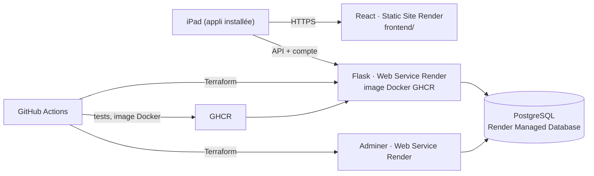

# Banc2Touche · plateforme Render

Banc2Touche est l'outil de banc pour coacher un match de handball sur iPad : saisie des tirs, gardiens, bilan de mi-temps, fiche PDF de fin de match. Ce dépôt en fait une plateforme industrielle, d'après l'[atelier Render](docs/ATELIER.md) : chaque commit est testé puis déployé sans intervention manuelle.

Auteur : Alinoé Quinquet

## Architecture



| Brique | Rôle | Créée par |
|---|---|---|
| **React** (`frontend/`) | L'appli Banc2Touche, installable sur l'iPad et utilisable sans réseau une fois connecté. React monte l'appli et gère la synchronisation avec le serveur. | Render, Static Site (interface) |
| **Flask** (`app/`) | API des comptes et des sauvegardes : chaque coach se connecte avec son identifiant et son mot de passe, puis envoie l'effectif et les matchs de son iPad. | Terraform (Web Service, image Docker) |
| **PostgreSQL** | Stocke les comptes (mots de passe hachés) et les 50 dernières versions envoyées. | Render, Managed Database (interface) |
| **Adminer** | Consulter la base dans le navigateur. | Terraform (Web Service, image `adminer`) |

## Chaîne CI/CD (`.github/workflows/deploy.yml`)

À chaque commit sur `main` :

1. **Tests API** : `pytest` sur une vraie base PostgreSQL 16.
2. **Build front** : `npm ci && npm run build`, et une vérification qu'aucune liste nominative de joueurs n'est dans le dépôt public.
3. **Image Docker** de l'API, publiée sur GHCR (`ghcr.io/<owner>/b2t-api:<sha>`).
4. **Terraform** crée l'API et Adminer sur Render s'ils n'existent pas encore. Les services déjà créés sont mis à jour sur place par l'API Render (variables d'environnement, puis nouvelle image), donc leur adresse ne change pas. Le Static Site est reconstruit à la fin.
5. **Vérification** : le workflow attend que `/info` réponde avec la nouvelle version, puis affiche les adresses dans le résumé du run.

Le Static Site se redéploie tout seul à chaque commit, Render suit la branche `main`.

## Mise en service (une seule fois)

1. **Base de données** : Render → New → Postgres, région **Frankfurt**, plan Free. Copier l'**Internal Database URL**.
2. **Secrets GitHub** (Settings → Secrets and variables → Actions) :
   - `RENDER_API_KEY` : Render → Account settings → API Keys
   - `RENDER_OWNER_ID` : Render → Workspace settings (ex. `tea-…`)
   - `DATABASE_URL` : l'Internal Database URL de l'étape 1
   - `B2T_ADMIN_USER` : ton identifiant de responsable (3 à 40 caractères : lettres sans accent, chiffres, point ou tiret)
   - `B2T_ADMIN_PASSWORD` : ton mot de passe de départ (8 caractères au minimum), à ne donner à personne
3. **Activer les Actions** (onglet Actions du fork), puis faire un commit. Le résumé du run donne l'adresse de l'API.
4. **Front** : Render → New → Static Site → Public Git Repository → ce dépôt (déjà créé : https://banc2touche.onrender.com)
   - Root Directory : `frontend`
   - Build Command : `npm ci && npm run build`
   - Publish Directory : `build`
   - Variable d'environnement : `B2T_API_URL` = adresse de l'API (étape 3)
5. *(Facultatif)* Variable GitHub `FRONTEND_ORIGIN` = adresse du Static Site, pour n'autoriser que lui à appeler l'API.

Si Render n'arrive pas à télécharger l'image : GitHub → Packages → `b2t-api` → Package settings → Change visibility → **Public**.

## Comptes et connexion

L'appli ne s'ouvre qu'après connexion (identifiant + mot de passe). Une fois connecté, l'appareil garde sa session : l'appli marche ensuite sans réseau, au bord du terrain.

**Un seul responsable.** Son compte est créé au démarrage du serveur à partir des secrets `B2T_ADMIN_USER` et `B2T_ADMIN_PASSWORD`. Il n'existe aucune inscription libre, et l'API ne permet ni de créer un second responsable ni de retirer le premier. Lui seul voit la gestion des comptes, dans **Effectif → Compte** :

- créer un compte (nom affiché, identifiant, mot de passe, avec un bouton « Proposer » pour un mot de passe solide) ;
- changer l'identifiant ou le mot de passe d'un coach, ce qui déconnecte ses appareils ;
- désactiver un compte (accès coupé tout de suite, réactivable) ou le supprimer ;
- voir la dernière connexion et le nombre d'appareils connectés de chacun.

Chaque coach peut changer son propre mot de passe et se déconnecter depuis la même page.

**Mot de passe du responsable oublié** : change le secret `B2T_ADMIN_PASSWORD` puis relance le workflow. Au redémarrage, ce nouveau mot de passe est appliqué et tes sessions sont fermées. Tant que le secret ne change pas, le mot de passe choisi dans l'appli est conservé.

**Sécurité** : les mots de passe sont hachés (scrypt), jamais stockés ni renvoyés en clair ; les jetons de session sont stockés sous forme d'empreinte et expirent après 90 jours sans utilisation ; après 5 essais ratés de suite, l'identifiant doit patienter (30 secondes, puis jusqu'à 15 minutes).

**Limite à connaître** : l'écran de connexion protège l'accès au serveur et à l'appli, pas les données déjà enregistrées sur un iPad. Un coach désactivé perd l'accès à l'appli dès que son appareil retrouve du réseau, mais l'effectif déjà présent dans la mémoire de son appareil n'est pas effacé à distance.

## Changer de base de données

La base gratuite de Render expire 30 jours après sa création. Pour passer à une nouvelle base (gratuite ou payante) sans rien perdre :

1. **Avant l'expiration**, dans l'appli : **Effectif → Compte → Changer de base de données → Exporter le fichier de transfert**. Range le fichier dans ton iCloud.
2. Crée la nouvelle base sur Render (New → Postgres, région Frankfurt) et copie son **Internal Database URL**.
3. Remplace le secret GitHub `DATABASE_URL` par cette adresse, puis relance le workflow (onglet Actions → CI/CD Banc2Touche → Run workflow, branche `main`).
4. Dans l'appli, reconnecte-toi avec le mot de passe du secret `B2T_ADMIN_PASSWORD`, puis **Importer un fichier** → **Importer dans cette base**.

Les comptes, leurs mots de passe, les appareils connectés et les 5 dernières sauvegardes reviennent tels quels : les coachs n'ont pas à se reconnecter. Fais l'import juste après le déploiement : un appareil qui s'ouvre entre les deux est déconnecté.

Le fichier contient les mots de passe sous forme hachée et l'effectif (des mineurs). Il ne va jamais dans GitHub : le dépôt est public.

## Routes de l'API

| Route | Accès | Rôle |
|---|---|---|
| `GET /health` | libre | état du service et de la base |
| `GET /info` | libre | nom de l'appli, auteur, version déployée (exercice 1) |
| `GET /env` | libre | variable `ENV` injectée par Terraform (exercice 2) |
| `POST /api/auth/login` | libre | `{"username", "password", "device"}` → jeton de session |
| `GET /api/auth/me` | connecté | le compte connecté |
| `POST /api/auth/logout` | connecté | ferme la session |
| `POST /api/auth/password` | connecté | change son propre mot de passe `{"current", "new"}` |
| `GET /api/users` | responsable | liste des comptes |
| `POST /api/users` | responsable | crée un compte `{"username", "name", "password"}` |
| `PATCH /api/users/<id>` | responsable | modifie `{"username", "name", "password", "active"}` |
| `DELETE /api/users/<id>` | responsable | supprime un compte |
| `GET /api/admin/export` | responsable | fichier de transfert : comptes, appareils connectés, 5 dernières sauvegardes |
| `POST /api/admin/import` | responsable | remet ce fichier dans la base |
| `GET /api/backups` | connecté | liste des versions enregistrées |
| `GET /api/backups/latest` | connecté | dernière version complète |
| `GET /api/backups/<id>` | connecté | une version complète |
| `POST /api/backups` | connecté | enregistre `{"device": "...", "data": {...}}` |

Le jeton de session passe dans l'en-tête `Authorization: Bearer <jeton>`.

## Développement en local

```bash
# API (SQLite par défaut, ou DATABASE_URL=postgresql://...)
pip install -r app/requirements.txt pytest
python -m pytest -q app/tests
ADMIN_USERNAME=moi ADMIN_PASSWORD=motdepasse python app/app.py   # http://localhost:10000

# Front
cd frontend && npm ci
B2T_API_URL=http://localhost:10000 npm run serve   # http://localhost:8080
```

## Données et limites

- **Données personnelles** : l'effectif contient des mineurs. Aucune liste de joueurs n'est dans ce dépôt public : elle arrive par l'appli, et seuls les comptes créés par le responsable y ont accès. Adminer demande les identifiants de la base. Le mettre en pause quand on ne s'en sert pas.
- **Plan gratuit Render** : une base PostgreSQL gratuite expire **30 jours** après sa création (14 jours de grâce pour passer à un plan payant). Voir « Changer de base de données » pour passer à une nouvelle base sans rien perdre. Un service web gratuit s'endort après 15 minutes sans visite et met environ une minute à se réveiller. L'appli reste utilisable sans réseau pendant ce temps.
- **Sans réseau** : seule la première connexion demande du réseau. Ensuite la saisie en match ne dépend jamais du serveur. La synchronisation se fait quand on veut, depuis Effectif → Sauvegarde → « Synchroniser avec le serveur ».
